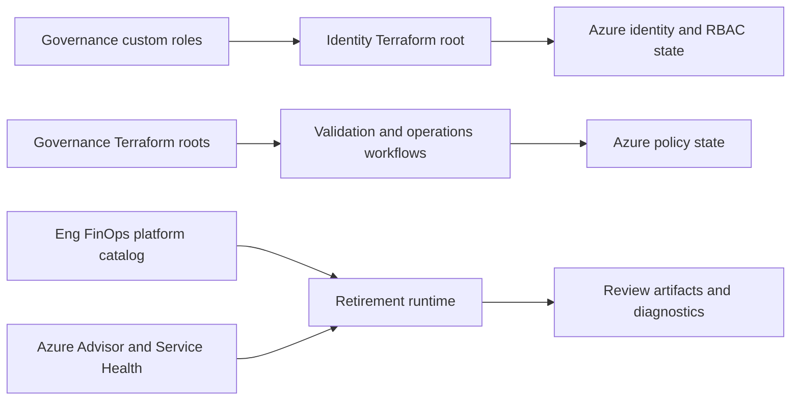

# Architecture

- Serves: PUR, PRI-03

## 1. Purpose

`eng-azure-governance` contains Azure policy governance, workload identity, an Eng FinOps subscription catalog, and an Azure retirement evidence runtime. This document describes its current components, state and schema boundaries, dependencies, workflows, and validation paths.

## 2. System overview

Azure Governance defines custom roles, policy definitions, policy sets, and assignments in numbered Terraform roots.
Identity provisions the production user-assigned identity, GitHub environment federation, and Azure role grants in separate Terraform state.
The Eng FinOps Platform Catalog maps subscriptions to platforms under a versioned YAML schema.
Azure Retirement Intelligence collects Azure evidence with the v2 runtime and consumes active platform mappings while producing review artifacts.
GitHub Actions validate source, detect drift, and invoke remediation or container-job operations.
Checked-in files evidence two cross-domain dependencies but do not bind Identity outputs to GitHub secret values.

The diagram shows the two evidenced cross-domain edges: governance-defined role names are consumed by Identity grants, and active catalog mappings are consumed during retirement aggregation.

## 3. Current vs intended architecture

| Area | Current architecture | Intended architecture | Status | Evidence |
| --- | --- | --- | --- | --- |
| Azure Governance | Numbered Terraform roots define roles, policy families, policy sets, and assignments. | No separate intended architecture is documented; preserve the current stage separation. | Documented | `README.md`, `src/azure-policy/01_custom_roles/`, `src/azure-policy/02_policy_*`, `src/azure-policy/03_policy_set/`, `src/azure-policy/04_policy_assignments/` |
| Identity | A hidden Terraform root provisions the production identity, GitHub environment federation, and Azure role grants in independent state. | No separate intended architecture is documented. | Evidenced | `.identity/00_main.tf`, `.identity/02_identity_prod.tf`, `.identity/02_identity_prod_auth.tf`, `.identity/env/prod/backend.tfvars` |
| Eng FinOps Platform Catalog | A versioned YAML catalog maps Azure subscriptions to organizational platforms and is read by the retirement runtime by subscription ID. | No separate intended architecture is documented. | Accepted | `src/_source_of_truth/README.md`, `src/_source_of_truth/eng-finops-platforms.yaml`, `src/comitato/comitato_azure_retirements_v2/retirements/adapters/filesystem/platform_catalog_yaml.py`, [ADR-0003](adr/0003-catalog-matching-keys.md) |
| Azure Retirement Intelligence | The v2 Python runtime collects, normalizes, and projects retirement evidence. | No separate intended architecture is documented; preserve the runtime contracts and explicit diagnostics. | Documented | `src/comitato/comitato_azure_retirements_v2/README.md` |

## 4. Technology stack

| Area | Technology | Status | Evidence |
| --- | --- | --- | --- |
| Governance definitions | Terraform and AzureRM resources | Evidenced | `src/azure-policy/01_custom_roles/`, `src/azure-policy/02_policy_api_management/`, `src/azure-policy/03_policy_set/`, `src/azure-policy/04_policy_assignments/`, `.terraform-version` |
| Workload identity | Terraform with AzureRM and AzureAD providers | Evidenced | `.identity/00_main.tf`, `.identity/.terraform.lock.hcl` |
| Platform catalog | YAML schema with a Python reader in the retirement runtime | Evidenced | `src/_source_of_truth/eng-finops-platforms.yaml`, `src/comitato/comitato_azure_retirements_v2/retirements/adapters/filesystem/platform_catalog_yaml.py` |
| Governance automation | Bash, Azure CLI, GitHub Actions | Evidenced | `src/scripts/*.sh`, `.github/workflows/` |
| Retirement runtime v2 | Python 3.13.9 CLI with a `retirements/` package | Documented | `src/comitato/comitato_azure_retirements_v2/README.md`, `src/comitato/comitato_azure_retirements_v2/requirements.txt` |
| Validation | pre-commit, Terraform validation, Ruff, ShellCheck, Python compile checks, pytest | Evidenced | `.pre-commit-config.yaml`, `.github/workflows/_pre-commit.yml`, `.github/workflows/_code-analysis.yml` |

## 5. Repository map

| Path | Responsibility | Notes |
| --- | --- | --- |
| `.identity/` | Provisions the production workload identity, federation, and Azure role grants. | Independent Terraform backend and wrapper. |
| `src/azure-policy/01_custom_roles/` | Defines custom Azure RBAC roles. | First numbered governance stage. |
| `src/azure-policy/02_policy_*/` | Defines service- or concern-specific Azure Policy families. | Each family has its own Terraform wrapper and state configuration. |
| `src/azure-policy/03_policy_set/` | Groups policy definitions into initiatives. | Reads the governance hierarchy and composes policy sets. |
| `src/azure-policy/04_policy_assignments/` | Assigns policy controls to governance scopes. | Final numbered governance stage. |
| `src/_source_of_truth/` | Owns the canonical Eng FinOps platform catalog. | Consumed by the retirement runtime. |
| `src/scripts/` | Runs remediation and container job scaling operations. | Invoked by dedicated workflows. |
| `scripts/` | Owns the shared Terraform wrapper, local Terraform-directory cleanup, and Graphify watcher. | Local operator entrypoints; `Makefile` exposes Graphify commands. |
| `src/comitato/comitato_azure_retirements_v2/` | v2 runtime: publishes validated monthly bundles and committee editorial data. | Canonical `retirements/` package with a separate launcher and dependency manifests. |
| `tests/comitato/comitato_azure_retirements_v2/` | Tests the v2 runtime. | Executed in a separate code-analysis environment. |
| `.github/workflows/` | Validates, releases, detects drift, remediates, and runs automation. | Workflows use pinned action revisions. |
| `docs/domain/` | Defines the four repository vocabularies, the cross-context glossary, and evidenced rules. | Selected through `GLOSSARY-MAP.md`. |
| `.pre-commit-config.yaml` | Defines local and CI validation hooks. | Terraform, Python, Bash, YAML, JSON, and action checks. |

The v2 runtime is a Python CLI with one entry script and a canonical
`retirements/` package. Its source, dependency manifests, and acceptance tests
are in `src/comitato/comitato_azure_retirements_v2/` and
`tests/comitato/comitato_azure_retirements_v2/`. The code-analysis workflow
runs the v2 tests in their own hash-locked environment.

## 6. Architectural boundaries

- **Governance definitions to Azure state - downstream:** Terraform roots describe Azure roles, policies, initiatives, and assignments; workflows and wrappers execute the changes. Evidence: `src/azure-policy/01_custom_roles/`, `src/azure-policy/02_policy_*`, `src/azure-policy/03_policy_set/`, `src/azure-policy/04_policy_assignments/`, `.github/workflows/`.
- **Azure Governance to Identity - downstream:** Identity grants reference the governance-defined `PagoPA Policy Reader` and `PagoPA Policy Remediator` roles by stable name. Evidence: `src/azure-policy/01_custom_roles/01_policy_reader.tf`, `src/azure-policy/01_custom_roles/01_policy_remediator.tf`, `.identity/02_identity_prod_auth.tf`.
- **Identity root to Azure identity state - downstream:** the root provisions a user-assigned identity, repository federation, and role grants through its own backend. Evidence: `.identity/00_main.tf`, `.identity/02_identity_prod.tf`, `.identity/02_identity_prod_auth.tf`, `.identity/env/prod/backend.tfvars`.
- **Governance workflows to Azure - downstream:** drift detection and remediation authenticate with Azure and operate on policy state. Evidence: `.github/workflows/terraform_drift.yml`, `.github/workflows/policy_remediation.yml`, `src/scripts/policy_remediation.sh`.
- **Eng FinOps Platform Catalog to retirement runtime - downstream:** the runtime loads active subscription-to-platform mappings from the canonical catalog, matching by subscription ID as recorded in ADR-0003. Evidence: `src/_source_of_truth/eng-finops-platforms.yaml`, `src/comitato/comitato_azure_retirements_v2/retirements/adapters/filesystem/platform_catalog_yaml.py`.
- **Azure sources to retirement runtime - upstream:** Advisor and Service Health APIs provide source evidence to the retirement runtime. Evidence: `src/comitato/comitato_azure_retirements_v2/retirements/adapters/azure/`.
- **Retirement runtime to review artifacts - downstream:** the runtime publishes a validated monthly bundle. Evidence: `src/comitato/comitato_azure_retirements_v2/README.md`.
- **Azure Retirement v2 internal boundaries:** the entry script delegates to
    `retirements/`. Azure and filesystem adapters feed application orchestration;
    contracts, domain rules, and report normalizers shape artifacts; publication
    validates and writes them. Evidence:
    `src/comitato/comitato_azure_retirements_v2/README.md` and
    `src/comitato/comitato_azure_retirements_v2/retirements/`.
- **Other domain pairs - free:** no other domain-to-domain data or control dependency is evidenced. In particular, repository files do not map `.identity` outputs to GitHub environment secret values. Evidence: `GLOSSARY-MAP.md`, `.identity/99_outputs.tf`, `.github/workflows/`.

## 7. Dependency rules

### Allowed direction

- Governance changes flow from custom roles to policy definitions, initiatives, and assignments in numbered apply order; later roots consume earlier remote state where declared.
- Identity grants may reference existing governance-defined custom roles by stable name.
- Active platform mappings flow from the canonical catalog into retirement aggregate and slide artifacts.
- Azure retirement evidence flows from Azure source APIs through the runtime to documented review artifacts.

### Avoid / forbidden

- Keep Identity grants in `.identity` and custom role definitions in `src/azure-policy/01_custom_roles/`; changing that boundary requires a new architectural decision. Evidence: `README.md`, `docs/adr/0001-domain-layout.md`.
- Match catalog entries by subscription ID. Never expose disabled or deleted entries as active mappings. Evidence: [ADR-0003](adr/0003-catalog-matching-keys.md), `docs/domain/eng-finops-platform-catalog/RULES.md`.
- Do not infer Service Health resource impact from names, regions, or labels. Evidence: `src/comitato/comitato_azure_retirements_v2/README.md`.
- Do not validate Terraform against a remote backend in the local pre-commit path. Evidence: `.github/workflows/_pre-commit.yml`, `.pre-commit-config.yaml`.

## 8. Key flows

### Build/test flow

1. The pre-commit workflow runs repository hooks, including Terraform formatting and validation, actionlint, ShellCheck, Python checks, and Terraform linting.
2. The code-analysis workflow creates an ephemeral Python environment from the repository version and locked requirements.
3. It compiles Python, parses Bash scripts, and runs the v2 retirement pytest suite in its own environment.

### Deployment/operations flow

1. Terraform roots are operated through their local `terraform.sh` wrappers; no checked-in workflow applies the numbered roots or `.identity`.
2. Terraform drift detection loops through the immediate directories under `src/` and `src/azure-policy/` that own a `terraform.sh` wrapper and invokes `./terraform.sh plan`.
3. The policy remediation workflow authenticates to Azure and creates remediation tasks for non-compliant definitions in selected policy sets.
4. The container app job workflow queries Azure Resource Graph and scales matching self-hosted-runner jobs to zero minimum executions.
5. Failure notifications are sent through the configured Slack action in the operational workflows.

## 9. Configuration and environment

- `.terraform-version` selects the Terraform version used by drift and local wrappers.
- Governance Terraform roots use a root `backend.ini` or an environment directory, depending on the local wrapper; wrapper arguments are not uniform. Evidence: `src/azure-policy/01_custom_roles/backend.ini`, `src/azure-policy/01_custom_roles/terraform.sh`, `src/azure-policy/04_policy_assignments/env/org/`, `src/azure-policy/04_policy_assignments/terraform.sh`.
- `.identity/env/prod/` configures the independent Identity backend and variables; documentation does not reproduce checked-in identifiers.
- `.python-version` selects Python `3.13.9` for the retirement launcher and CI.
- `src/_source_of_truth/eng-finops-platforms.yaml` is the canonical catalog used during retirement aggregation.
- Retirement CLI flags select scope and output, such as `--subscriptions`, `--management-groups`, and `--output-root`. Evidence: `src/comitato/comitato_azure_retirements_v2/retirements/config.py`.
- Workflows obtain Azure access through GitHub environment secrets and OIDC permissions. Their checked-in definitions do not prove how those secret values relate to `.identity` outputs.

## 10. Testing and validation

| Change type | Suggested validation | Evidence |
| --- | --- | --- |
| Identity Terraform | Terraform format check and backend-disabled pre-commit validation. | `.identity/`, `.pre-commit-config.yaml`, `.github/workflows/_pre-commit.yml` |
| Governance Terraform or policy definition | Terraform format check, backend-disabled pre-commit validation, and a wrapper plan where Azure access is available. | `.pre-commit-config.yaml`, `.github/workflows/_pre-commit.yml`, `.github/PULL_REQUEST_TEMPLATE.md` |
| Platform catalog | Focused platform-catalog tests, followed by the retirement suites when consumer behavior changes. | `tests/comitato/comitato_azure_retirements_v2/adapters/test_platform_catalog_yaml.py`, `Makefile` |
| Bash workflow or operational script | Bash syntax check and ShellCheck; actionlint for workflow changes. | `.pre-commit-config.yaml`, `.github/workflows/_code-analysis.yml` |
| Retirement runtime v2 | v2 test suite. | `.github/workflows/_code-analysis.yml`, `tests/comitato/comitato_azure_retirements_v2/`, `src/comitato/comitato_azure_retirements_v2/README.md` |
| Documentation | Markdown syntax plus local link and anchor checks, then pre-commit on the selected paths. | `.github/instructions/internal-markdown.instructions.md`, `.pre-commit-config.yaml` |

## 11. Architectural decisions visible in the repo

| Decision | Status | Evidence | Trade-off | Related ADR |
| --- | --- | --- | --- | --- |
| Separate governance controls into numbered role, policy, policy-set, and assignment roots. | Evidenced | `README.md`, `src/azure-policy/01_custom_roles/`, `src/azure-policy/02_policy_*`, `src/azure-policy/03_policy_set/`, `src/azure-policy/04_policy_assignments/` | Clear apply boundaries at the cost of many Terraform roots. | None |
| Provision the production workload identity and grants in an independent Terraform root. | Evidenced | `.identity/` | Isolates identity state at the cost of a separate execution path. | None |
| Keep the platform catalog versioned and expose only active mappings to the runtime, keyed by subscription ID. | Accepted | `src/_source_of_truth/README.md`, `src/comitato/comitato_azure_retirements_v2/retirements/adapters/filesystem/platform_catalog_yaml.py` | Preserves lifecycle history while excluding inactive entries from current reporting. | [ADR-0003](adr/0003-catalog-matching-keys.md) |
| Publish v2 retirement artifacts as one validated monthly bundle. | Documented | `src/comitato/comitato_azure_retirements_v2/README.md` | A failed run never alters the current bundle; a new run replaces the month whole. | None |
| Use a four-domain glossary map for repository knowledge. | Accepted | `GLOSSARY-MAP.md`, `docs/domain/` | Preserves distinct vocabularies and boundaries at the cost of additional navigation. | [ADR-0001](adr/0001-domain-layout.md), [ADR-0002](adr/0002-glossary-file-names.md) |

## 12. AI-agent working rules

- Read this document, `GLOSSARY-MAP.md`, and the applicable domain glossary and rules before making structural changes.
- Preserve existing repository patterns and boundaries; keep changes scoped to the owning domain or component.
- Prefer existing repository patterns over new abstractions.
- Do not introduce new frameworks or cross-cutting refactors without explicit approval.
- Update this document when an intentional architectural change alters a boundary, flow, dependency, or state lifecycle.
- Report evidence conflicts to the repository owner before editing; do not record them as warnings or open questions in this document.
