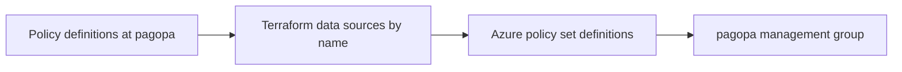

# Azure Policy Sets

This Terraform root composes the repository's policy families into Azure Policy initiatives.

## Purpose

Use this directory for the policy-set stage after policy definitions are available. The `01_*.tf` files define environment- and concern-specific `azurerm_policy_set_definition` resources, resolve policy definition IDs by name at the `pagopa` management group through `data "azurerm_policy_definition"`, and expose the initiative IDs listed in the generated Terraform reference below. Start with the policy-set file for the environment or concern being changed, then use the local `terraform.sh` wrapper for the supported Terraform lifecycle actions.

The composition flow is from the policy definitions published at the `pagopa` management group through name-based data sources to policy-set definitions scoped to the same management group:



## Validation

From this directory, run non-remote Terraform validation:

```bash
terraform fmt -check .
terraform init -backend=false -lockfile=readonly
```

## Kubernetes policy sets

The Kubernetes sets live in `01_kubernetes_dev.tf`, `01_kubernetes_uat.tf`, and `01_kubernetes_prod.tf`.

- `kubernetes_dev` and `kubernetes_uat` each contain three explicit Audit references: privileged containers, privilege escalation, and approved user groups. Each reference uses the same excluded namespaces. Neither set contains a PDB control.
- `kubernetes_prod` adds the accurate PDB built-in and the custom `kubernetes_required_pdb` control, both as Audit. The 11 existing PROD references are unchanged.

The DEV and UAT references may report existing workloads, including non-root defaults. Expect noise at first and review it before any change of effect.

## Rollout runbook

Apply the Kubernetes roots in this order: 02, then 03, then 04.

- Applying 03 activates the PROD set. The new PROD references take effect before any environment assignment in 04.
- Each apply is a human gate. This README does not authorize Azure changes.
- Before treating PDB results as current, check the compliance timestamp. Compliance can lag by up to 15 minutes and reports stop at 500 non-compliant records per policy per cluster. See [the required PDB control](../02_policy_kubernetes/README.md#required-poddisruptionbudget-control) for the full limits.
- Rollback for the PDB control is the `required_pdb` effect set to `Disabled` in `01_kubernetes_prod.tf`, followed by an apply of this root.

<!-- BEGIN_TF_DOCS -->
## Requirements

| Name | Version |
|------|---------|
| <a name="requirement_terraform"></a> [terraform](#requirement\_terraform) | >=1.3.0 |
| <a name="requirement_azurerm"></a> [azurerm](#requirement\_azurerm) | ~> 4.63.0 |

## Providers

| Name | Version |
|------|---------|
| <a name="provider_azurerm"></a> [azurerm](#provider\_azurerm) | 4.63.0 |

## Modules

No modules.

## Resources

| Name | Type |
|------|------|
| [azurerm_policy_set_definition.api_management_dev](https://registry.terraform.io/providers/hashicorp/azurerm/latest/docs/resources/policy_set_definition) | resource |
| [azurerm_policy_set_definition.api_management_prod](https://registry.terraform.io/providers/hashicorp/azurerm/latest/docs/resources/policy_set_definition) | resource |
| [azurerm_policy_set_definition.api_management_uat](https://registry.terraform.io/providers/hashicorp/azurerm/latest/docs/resources/policy_set_definition) | resource |
| [azurerm_policy_set_definition.app_service_dev](https://registry.terraform.io/providers/hashicorp/azurerm/latest/docs/resources/policy_set_definition) | resource |
| [azurerm_policy_set_definition.app_service_prod](https://registry.terraform.io/providers/hashicorp/azurerm/latest/docs/resources/policy_set_definition) | resource |
| [azurerm_policy_set_definition.app_service_uat](https://registry.terraform.io/providers/hashicorp/azurerm/latest/docs/resources/policy_set_definition) | resource |
| [azurerm_policy_set_definition.application_gateway_prod](https://registry.terraform.io/providers/hashicorp/azurerm/latest/docs/resources/policy_set_definition) | resource |
| [azurerm_policy_set_definition.audit_logs](https://registry.terraform.io/providers/hashicorp/azurerm/latest/docs/resources/policy_set_definition) | resource |
| [azurerm_policy_set_definition.container_apps_dev](https://registry.terraform.io/providers/hashicorp/azurerm/latest/docs/resources/policy_set_definition) | resource |
| [azurerm_policy_set_definition.container_apps_prod](https://registry.terraform.io/providers/hashicorp/azurerm/latest/docs/resources/policy_set_definition) | resource |
| [azurerm_policy_set_definition.container_apps_uat](https://registry.terraform.io/providers/hashicorp/azurerm/latest/docs/resources/policy_set_definition) | resource |
| [azurerm_policy_set_definition.cosmosdb_dev](https://registry.terraform.io/providers/hashicorp/azurerm/latest/docs/resources/policy_set_definition) | resource |
| [azurerm_policy_set_definition.cosmosdb_prod](https://registry.terraform.io/providers/hashicorp/azurerm/latest/docs/resources/policy_set_definition) | resource |
| [azurerm_policy_set_definition.cosmosdb_uat](https://registry.terraform.io/providers/hashicorp/azurerm/latest/docs/resources/policy_set_definition) | resource |
| [azurerm_policy_set_definition.data_sovereignty_eu](https://registry.terraform.io/providers/hashicorp/azurerm/latest/docs/resources/policy_set_definition) | resource |
| [azurerm_policy_set_definition.dns](https://registry.terraform.io/providers/hashicorp/azurerm/latest/docs/resources/policy_set_definition) | resource |
| [azurerm_policy_set_definition.event_hub_prod](https://registry.terraform.io/providers/hashicorp/azurerm/latest/docs/resources/policy_set_definition) | resource |
| [azurerm_policy_set_definition.key_vault_prod](https://registry.terraform.io/providers/hashicorp/azurerm/latest/docs/resources/policy_set_definition) | resource |
| [azurerm_policy_set_definition.kubernetes_dev](https://registry.terraform.io/providers/hashicorp/azurerm/latest/docs/resources/policy_set_definition) | resource |
| [azurerm_policy_set_definition.kubernetes_prod](https://registry.terraform.io/providers/hashicorp/azurerm/latest/docs/resources/policy_set_definition) | resource |
| [azurerm_policy_set_definition.kubernetes_uat](https://registry.terraform.io/providers/hashicorp/azurerm/latest/docs/resources/policy_set_definition) | resource |
| [azurerm_policy_set_definition.log_analytics_dev](https://registry.terraform.io/providers/hashicorp/azurerm/latest/docs/resources/policy_set_definition) | resource |
| [azurerm_policy_set_definition.log_analytics_prod](https://registry.terraform.io/providers/hashicorp/azurerm/latest/docs/resources/policy_set_definition) | resource |
| [azurerm_policy_set_definition.log_analytics_uat](https://registry.terraform.io/providers/hashicorp/azurerm/latest/docs/resources/policy_set_definition) | resource |
| [azurerm_policy_set_definition.networking_prod](https://registry.terraform.io/providers/hashicorp/azurerm/latest/docs/resources/policy_set_definition) | resource |
| [azurerm_policy_set_definition.postgresql_dev](https://registry.terraform.io/providers/hashicorp/azurerm/latest/docs/resources/policy_set_definition) | resource |
| [azurerm_policy_set_definition.postgresql_prod](https://registry.terraform.io/providers/hashicorp/azurerm/latest/docs/resources/policy_set_definition) | resource |
| [azurerm_policy_set_definition.postgresql_uat](https://registry.terraform.io/providers/hashicorp/azurerm/latest/docs/resources/policy_set_definition) | resource |
| [azurerm_policy_set_definition.redis_dev](https://registry.terraform.io/providers/hashicorp/azurerm/latest/docs/resources/policy_set_definition) | resource |
| [azurerm_policy_set_definition.redis_prod](https://registry.terraform.io/providers/hashicorp/azurerm/latest/docs/resources/policy_set_definition) | resource |
| [azurerm_policy_set_definition.redis_uat](https://registry.terraform.io/providers/hashicorp/azurerm/latest/docs/resources/policy_set_definition) | resource |
| [azurerm_policy_set_definition.resource_lock](https://registry.terraform.io/providers/hashicorp/azurerm/latest/docs/resources/policy_set_definition) | resource |
| [azurerm_policy_set_definition.storage_account_prod](https://registry.terraform.io/providers/hashicorp/azurerm/latest/docs/resources/policy_set_definition) | resource |
| [azurerm_policy_set_definition.tags](https://registry.terraform.io/providers/hashicorp/azurerm/latest/docs/resources/policy_set_definition) | resource |
| [azurerm_policy_set_definition.virtual_machine_dev](https://registry.terraform.io/providers/hashicorp/azurerm/latest/docs/resources/policy_set_definition) | resource |
| [azurerm_policy_set_definition.virtual_machine_prod](https://registry.terraform.io/providers/hashicorp/azurerm/latest/docs/resources/policy_set_definition) | resource |
| [azurerm_policy_set_definition.virtual_machine_scale_set_dev](https://registry.terraform.io/providers/hashicorp/azurerm/latest/docs/resources/policy_set_definition) | resource |
| [azurerm_policy_set_definition.virtual_machine_scale_set_prod](https://registry.terraform.io/providers/hashicorp/azurerm/latest/docs/resources/policy_set_definition) | resource |
| [azurerm_policy_set_definition.virtual_machine_scale_set_uat](https://registry.terraform.io/providers/hashicorp/azurerm/latest/docs/resources/policy_set_definition) | resource |
| [azurerm_policy_set_definition.virtual_machine_uat](https://registry.terraform.io/providers/hashicorp/azurerm/latest/docs/resources/policy_set_definition) | resource |
| [azurerm_management_group.pagopa](https://registry.terraform.io/providers/hashicorp/azurerm/latest/docs/data-sources/management_group) | data source |
| [azurerm_policy_definition.resource_lock](https://registry.terraform.io/providers/hashicorp/azurerm/latest/docs/data-sources/policy_definition) | data source |
| [azurerm_policy_definition.this](https://registry.terraform.io/providers/hashicorp/azurerm/latest/docs/data-sources/policy_definition) | data source |

## Inputs

| Name | Description | Type | Default | Required |
|------|-------------|------|---------|:--------:|
| <a name="input_subscription_id"></a> [subscription\_id](#input\_subscription\_id) | The Azure subscription ID to use | `string` | n/a | yes |
| <a name="input_allowed_locations"></a> [allowed\_locations](#input\_allowed\_locations) | List of allowed locations for resources | `list(string)` | <pre>[<br/>  "italynorth",<br/>  "northeurope",<br/>  "westeurope",<br/>  "spaincentral",<br/>  "germanywestcentral",<br/>  "global"<br/>]</pre> | no |
| <a name="input_allowed_locations_cosmosdb"></a> [allowed\_locations\_cosmosdb](#input\_allowed\_locations\_cosmosdb) | List of allowed locations for CosmosDB | `list(string)` | <pre>[<br/>  "italynorth",<br/>  "northeurope",<br/>  "westeurope",<br/>  "spaincentral",<br/>  "germanywestcentral"<br/>]</pre> | no |
| <a name="input_allowed_locations_resource_groups"></a> [allowed\_locations\_resource\_groups](#input\_allowed\_locations\_resource\_groups) | List of allowed locations for resource groups | `list(string)` | <pre>[<br/>  "italynorth",<br/>  "northeurope",<br/>  "westeurope",<br/>  "spaincentral",<br/>  "germanywestcentral"<br/>]</pre> | no |
| <a name="input_api_management_dev"></a> [api\_management\_dev](#input\_api\_management\_dev) | List of API Management policy set parameters | <pre>object({<br/>    listofallowedskusname = list(string)<br/>  })</pre> | <pre>{<br/>  "listofallowedskusname": [<br/>    "Developer"<br/>  ]<br/>}</pre> | no |
| <a name="input_api_management_prod"></a> [api\_management\_prod](#input\_api\_management\_prod) | List of API Management policy set parameters | <pre>object({<br/>    listofallowedskusname = list(string)<br/>  })</pre> | <pre>{<br/>  "listofallowedskusname": [<br/>    "Premium"<br/>  ]<br/>}</pre> | no |
| <a name="input_api_management_uat"></a> [api\_management\_uat](#input\_api\_management\_uat) | List of API Management policy set parameters | <pre>object({<br/>    listofallowedskusname = list(string)<br/>  })</pre> | <pre>{<br/>  "listofallowedskusname": [<br/>    "Developer"<br/>  ]<br/>}</pre> | no |
| <a name="input_app_service_dev"></a> [app\_service\_dev](#input\_app\_service\_dev) | List of app service policy set parameters | <pre>object({<br/>    listofallowedsku  = list(string)<br/>    listofallowedkind = list(string)<br/>  })</pre> | <pre>{<br/>  "listofallowedkind": [<br/>    "elastic",<br/>    "linux",<br/>    "functionapp"<br/>  ],<br/>  "listofallowedsku": [<br/>    "Y1",<br/>    "WS1",<br/>    "B1",<br/>    "B2",<br/>    "B3"<br/>  ]<br/>}</pre> | no |
| <a name="input_app_service_prod"></a> [app\_service\_prod](#input\_app\_service\_prod) | List of app service policy set parameters | <pre>object({<br/>    listofallowedsku  = list(string)<br/>    listofallowedkind = list(string)<br/>  })</pre> | <pre>{<br/>  "listofallowedkind": [<br/>    "elastic",<br/>    "linux"<br/>  ],<br/>  "listofallowedsku": [<br/>    "WS1",<br/>    "P0v3",<br/>    "P1v3"<br/>  ]<br/>}</pre> | no |
| <a name="input_app_service_uat"></a> [app\_service\_uat](#input\_app\_service\_uat) | List of app service policy set parameters | <pre>object({<br/>    listofallowedsku  = list(string)<br/>    listofallowedkind = list(string)<br/>  })</pre> | <pre>{<br/>  "listofallowedkind": [<br/>    "elastic",<br/>    "linux",<br/>    "functionapp"<br/>  ],<br/>  "listofallowedsku": [<br/>    "Y1",<br/>    "WS1",<br/>    "B1",<br/>    "B2",<br/>    "B3"<br/>  ]<br/>}</pre> | no |
| <a name="input_audit_logs_storage_id_italynorth"></a> [audit\_logs\_storage\_id\_italynorth](#input\_audit\_logs\_storage\_id\_italynorth) | description | `string` | `"/subscriptions/0da48c97-355f-4050-a520-f11a18b8be90/resourceGroups/sec-p-rg-nit/providers/Microsoft.Storage/storageAccounts/ppseclogsitn"` | no |
| <a name="input_audit_logs_storage_id_northeurope"></a> [audit\_logs\_storage\_id\_northeurope](#input\_audit\_logs\_storage\_id\_northeurope) | description | `string` | `"/subscriptions/0da48c97-355f-4050-a520-f11a18b8be90/resourceGroups/sec-p-rg-neu/providers/Microsoft.Storage/storageAccounts/ppseclogsneu"` | no |
| <a name="input_audit_logs_storage_id_westeurope"></a> [audit\_logs\_storage\_id\_westeurope](#input\_audit\_logs\_storage\_id\_westeurope) | description | `string` | `"/subscriptions/0da48c97-355f-4050-a520-f11a18b8be90/resourceGroups/sec-p-sentinel/providers/Microsoft.Storage/storageAccounts/ppseclogs"` | no |
| <a name="input_audit_logs_workspace_id"></a> [audit\_logs\_workspace\_id](#input\_audit\_logs\_workspace\_id) | description | `string` | `"/subscriptions/0da48c97-355f-4050-a520-f11a18b8be90/resourcegroups/sec-p-sentinel/providers/microsoft.operationalinsights/workspaces/sec-p-law"` | no |
| <a name="input_postgresql_dev"></a> [postgresql\_dev](#input\_postgresql\_dev) | List of PostgreSQL policy set parameters | <pre>object({<br/>    listofallowedskuname         = list(string)<br/>    listofallowedflexibleskuname = list(string)<br/>  })</pre> | <pre>{<br/>  "listofallowedflexibleskuname": [<br/>    "Standard_B1ms",<br/>    "Standard_B2s",<br/>    "Standard_B2ms"<br/>  ],<br/>  "listofallowedskuname": [<br/>    "B_Gen5_1",<br/>    "B_Gen5_2",<br/>    "GP_Gen5_2"<br/>  ]<br/>}</pre> | no |
| <a name="input_postgresql_prod"></a> [postgresql\_prod](#input\_postgresql\_prod) | List of PostgreSQL policy set parameters | <pre>object({<br/>    listofallowedflexibleskuname = list(string)<br/>    listofallowedskuname         = list(string)<br/>  })</pre> | <pre>{<br/>  "listofallowedflexibleskuname": [<br/>    "Standard_D2ds_v4",<br/>    "Standard_D4ds_v4",<br/>    "Standard_D8ds_v4",<br/>    "Standard_D2ds_v5",<br/>    "Standard_D4ds_v5",<br/>    "Standard_D8ds_v5"<br/>  ],<br/>  "listofallowedskuname": [<br/>    "GP_Gen5_2",<br/>    "GP_Gen5_4",<br/>    "GP_Gen5_8"<br/>  ]<br/>}</pre> | no |
| <a name="input_postgresql_uat"></a> [postgresql\_uat](#input\_postgresql\_uat) | List of PostgreSQL policy set parameters | <pre>object({<br/>    listofallowedskuname         = list(string)<br/>    listofallowedflexibleskuname = list(string)<br/>  })</pre> | <pre>{<br/>  "listofallowedflexibleskuname": [<br/>    "Standard_B1ms",<br/>    "Standard_B2s",<br/>    "Standard_B2ms"<br/>  ],<br/>  "listofallowedskuname": [<br/>    "GP_Gen5_2"<br/>  ]<br/>}</pre> | no |
| <a name="input_redis_dev"></a> [redis\_dev](#input\_redis\_dev) | List of redis policy set parameters | <pre>object({<br/>    listofallowedskuname     = list(string)<br/>    listofallowedskucapacity = list(string)<br/>  })</pre> | <pre>{<br/>  "listofallowedskucapacity": [<br/>    "0",<br/>    "1"<br/>  ],<br/>  "listofallowedskuname": [<br/>    "Basic"<br/>  ]<br/>}</pre> | no |
| <a name="input_redis_prod"></a> [redis\_prod](#input\_redis\_prod) | List of redis policy set parameters | <pre>object({<br/>    listofallowedskuname     = list(string)<br/>    listofallowedskucapacity = list(string)<br/>  })</pre> | <pre>{<br/>  "listofallowedskucapacity": [<br/>    "0",<br/>    "1",<br/>    "2"<br/>  ],<br/>  "listofallowedskuname": [<br/>    "Standard",<br/>    "Premium"<br/>  ]<br/>}</pre> | no |
| <a name="input_redis_uat"></a> [redis\_uat](#input\_redis\_uat) | List of redis policy set parameters | <pre>object({<br/>    listofallowedskuname     = list(string)<br/>    listofallowedskucapacity = list(string)<br/>  })</pre> | <pre>{<br/>  "listofallowedskucapacity": [<br/>    "0",<br/>    "1"<br/>  ],<br/>  "listofallowedskuname": [<br/>    "Basic"<br/>  ]<br/>}</pre> | no |
| <a name="input_virtual_machine_dev"></a> [virtual\_machine\_dev](#input\_virtual\_machine\_dev) | List of Virtual Machine policy set parameters | <pre>object({<br/>    listofallowedskuname = list(string)<br/>  })</pre> | <pre>{<br/>  "listofallowedskuname": [<br/>    "Standard_B2ms",<br/>    "Standard_B4ms",<br/>    "Standard_B8ms"<br/>  ]<br/>}</pre> | no |
| <a name="input_virtual_machine_prod"></a> [virtual\_machine\_prod](#input\_virtual\_machine\_prod) | List of Virtual Machine policy set parameters | <pre>object({<br/>    listofallowedskuname = list(string)<br/>  })</pre> | <pre>{<br/>  "listofallowedskuname": [<br/>    "Standard_D2ds_v5",<br/>    "Standard_D4ds_v5",<br/>    "Standard_D8ds_v5"<br/>  ]<br/>}</pre> | no |
| <a name="input_virtual_machine_scale_set_dev"></a> [virtual\_machine\_scale\_set\_dev](#input\_virtual\_machine\_scale\_set\_dev) | List of Virtual Machine policy set parameters | <pre>object({<br/>    listofallowedskuname = list(string)<br/>  })</pre> | <pre>{<br/>  "listofallowedskuname": [<br/>    "Standard_B2ms",<br/>    "Standard_B4ms",<br/>    "Standard_B8ms"<br/>  ]<br/>}</pre> | no |
| <a name="input_virtual_machine_scale_set_prod"></a> [virtual\_machine\_scale\_set\_prod](#input\_virtual\_machine\_scale\_set\_prod) | List of Virtual Machine policy set parameters | <pre>object({<br/>    listofallowedskuname = list(string)<br/>  })</pre> | <pre>{<br/>  "listofallowedskuname": [<br/>    "Standard_B2ms",<br/>    "Standard_B4ms",<br/>    "Standard_B8ms"<br/>  ]<br/>}</pre> | no |
| <a name="input_virtual_machine_scale_set_uat"></a> [virtual\_machine\_scale\_set\_uat](#input\_virtual\_machine\_scale\_set\_uat) | List of Virtual Machine policy set parameters | <pre>object({<br/>    listofallowedskuname = list(string)<br/>  })</pre> | <pre>{<br/>  "listofallowedskuname": [<br/>    "Standard_B2ms",<br/>    "Standard_B4ms",<br/>    "Standard_B8ms"<br/>  ]<br/>}</pre> | no |
| <a name="input_virtual_machine_uat"></a> [virtual\_machine\_uat](#input\_virtual\_machine\_uat) | List of Virtual Machine policy set parameters | <pre>object({<br/>    listofallowedskuname = list(string)<br/>  })</pre> | <pre>{<br/>  "listofallowedskuname": [<br/>    "Standard_B2ms",<br/>    "Standard_B4ms",<br/>    "Standard_B8ms"<br/>  ]<br/>}</pre> | no |

## Outputs

| Name | Description |
|------|-------------|
| <a name="output_api_management_dev_id"></a> [api\_management\_dev\_id](#output\_api\_management\_dev\_id) | n/a |
| <a name="output_api_management_prod_id"></a> [api\_management\_prod\_id](#output\_api\_management\_prod\_id) | n/a |
| <a name="output_api_management_uat_id"></a> [api\_management\_uat\_id](#output\_api\_management\_uat\_id) | n/a |
| <a name="output_app_service_dev_id"></a> [app\_service\_dev\_id](#output\_app\_service\_dev\_id) | n/a |
| <a name="output_app_service_prod_id"></a> [app\_service\_prod\_id](#output\_app\_service\_prod\_id) | n/a |
| <a name="output_app_service_uat_id"></a> [app\_service\_uat\_id](#output\_app\_service\_uat\_id) | n/a |
| <a name="output_application_gateway_prod_id"></a> [application\_gateway\_prod\_id](#output\_application\_gateway\_prod\_id) | n/a |
| <a name="output_audit_logs_id"></a> [audit\_logs\_id](#output\_audit\_logs\_id) | n/a |
| <a name="output_audit_logs_storage_id_italynorth"></a> [audit\_logs\_storage\_id\_italynorth](#output\_audit\_logs\_storage\_id\_italynorth) | n/a |
| <a name="output_audit_logs_storage_id_northeurope"></a> [audit\_logs\_storage\_id\_northeurope](#output\_audit\_logs\_storage\_id\_northeurope) | n/a |
| <a name="output_audit_logs_storage_id_westeurope"></a> [audit\_logs\_storage\_id\_westeurope](#output\_audit\_logs\_storage\_id\_westeurope) | n/a |
| <a name="output_audit_logs_workspace_id"></a> [audit\_logs\_workspace\_id](#output\_audit\_logs\_workspace\_id) | n/a |
| <a name="output_container_apps_dev_id"></a> [container\_apps\_dev\_id](#output\_container\_apps\_dev\_id) | n/a |
| <a name="output_container_apps_prod_id"></a> [container\_apps\_prod\_id](#output\_container\_apps\_prod\_id) | n/a |
| <a name="output_container_apps_uat_id"></a> [container\_apps\_uat\_id](#output\_container\_apps\_uat\_id) | n/a |
| <a name="output_cosmosdb_dev_id"></a> [cosmosdb\_dev\_id](#output\_cosmosdb\_dev\_id) | n/a |
| <a name="output_cosmosdb_prod_id"></a> [cosmosdb\_prod\_id](#output\_cosmosdb\_prod\_id) | n/a |
| <a name="output_cosmosdb_uat_id"></a> [cosmosdb\_uat\_id](#output\_cosmosdb\_uat\_id) | n/a |
| <a name="output_data_sovereignty_eu_id"></a> [data\_sovereignty\_eu\_id](#output\_data\_sovereignty\_eu\_id) | n/a |
| <a name="output_dns_id"></a> [dns\_id](#output\_dns\_id) | n/a |
| <a name="output_event_hub_prod_id"></a> [event\_hub\_prod\_id](#output\_event\_hub\_prod\_id) | n/a |
| <a name="output_key_vault_prod_id"></a> [key\_vault\_prod\_id](#output\_key\_vault\_prod\_id) | n/a |
| <a name="output_kubernetes_prod_id"></a> [kubernetes\_prod\_id](#output\_kubernetes\_prod\_id) | n/a |
| <a name="output_log_analytics_dev_id"></a> [log\_analytics\_dev\_id](#output\_log\_analytics\_dev\_id) | n/a |
| <a name="output_log_analytics_prod_id"></a> [log\_analytics\_prod\_id](#output\_log\_analytics\_prod\_id) | n/a |
| <a name="output_log_analytics_uat_id"></a> [log\_analytics\_uat\_id](#output\_log\_analytics\_uat\_id) | n/a |
| <a name="output_networking_prod_id"></a> [networking\_prod\_id](#output\_networking\_prod\_id) | n/a |
| <a name="output_postgresql_dev_id"></a> [postgresql\_dev\_id](#output\_postgresql\_dev\_id) | n/a |
| <a name="output_postgresql_prod_id"></a> [postgresql\_prod\_id](#output\_postgresql\_prod\_id) | n/a |
| <a name="output_postgresql_uat_id"></a> [postgresql\_uat\_id](#output\_postgresql\_uat\_id) | n/a |
| <a name="output_redis_dev_id"></a> [redis\_dev\_id](#output\_redis\_dev\_id) | n/a |
| <a name="output_redis_prod_id"></a> [redis\_prod\_id](#output\_redis\_prod\_id) | n/a |
| <a name="output_redis_uat_id"></a> [redis\_uat\_id](#output\_redis\_uat\_id) | n/a |
| <a name="output_resource_lock_id"></a> [resource\_lock\_id](#output\_resource\_lock\_id) | n/a |
| <a name="output_storage_account_prod_id"></a> [storage\_account\_prod\_id](#output\_storage\_account\_prod\_id) | n/a |
| <a name="output_tags_id"></a> [tags\_id](#output\_tags\_id) | n/a |
| <a name="output_virtual_machine_dev_id"></a> [virtual\_machine\_dev\_id](#output\_virtual\_machine\_dev\_id) | n/a |
| <a name="output_virtual_machine_prod_id"></a> [virtual\_machine\_prod\_id](#output\_virtual\_machine\_prod\_id) | n/a |
| <a name="output_virtual_machine_scale_set_dev_id"></a> [virtual\_machine\_scale\_set\_dev\_id](#output\_virtual\_machine\_scale\_set\_dev\_id) | n/a |
| <a name="output_virtual_machine_scale_set_prod_id"></a> [virtual\_machine\_scale\_set\_prod\_id](#output\_virtual\_machine\_scale\_set\_prod\_id) | n/a |
| <a name="output_virtual_machine_scale_set_uat_id"></a> [virtual\_machine\_scale\_set\_uat\_id](#output\_virtual\_machine\_scale\_set\_uat\_id) | n/a |
| <a name="output_virtual_machine_uat_id"></a> [virtual\_machine\_uat\_id](#output\_virtual\_machine\_uat\_id) | n/a |
<!-- END_TF_DOCS -->
