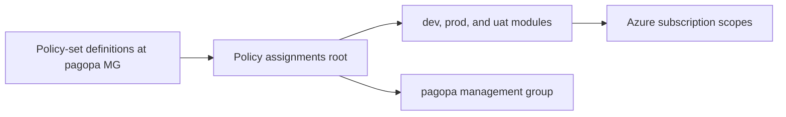

# Azure Policy Assignments

This Terraform root assigns Azure Policy controls to governance scopes.

## Purpose

Use this directory for the final governance stage. The root resolves policy-set IDs through `azurerm_policy_set_definition` data sources at the `pagopa` management group, applies direct management-group assignments and exemptions, and delegates environment-specific subscription assignments to the existing `modules/dev`, `modules/prod`, and `modules/uat` roots. Start with the root `01_*.tf` files or the environment module that owns the assignment being changed, then use the local `terraform.sh` wrapper for the supported Terraform lifecycle actions.

The assignment flow is from policy-set definitions through this root and its environment modules to subscription and management-group scopes:



## Validation

From this directory, run non-remote Terraform validation:

```bash
terraform fmt -check .
terraform init -backend=false -lockfile=readonly
terraform validate -no-color
```

Environment modules discover subscriptions directly from Azure and select only
those whose state is `Enabled`. No subscription allowlist is required.

Configure exclusions and environment exceptions in
[`env/org/terraform.tfvars`](env/org/terraform.tfvars):

- `subscription_blacklist` excludes display names or subscription UUIDs.
- `subscription_environment_overrides` maps display names or UUIDs to `dev`,
    `uat`, or `prod`. UUID overrides take precedence over display-name overrides.
- Without an override, the `DEV-`, `UAT-`, and `PROD-` prefixes select the
    environment. Matching ignores case. Blacklist and override entries are trimmed.
- An active subscription without a recognized prefix or override stops the plan
    and reports its name. Duplicate active display names also stop the plan.

Blacklist exclusions take precedence over environment overrides. Existing
exceptions such as `DevOpsLab`, `ORG`, and `Common` are explicitly mapped in the
environment configuration. Module keys remain the Azure display names.

Discovery is limited to subscriptions visible to the provider credentials.
Lost read access, blacklisting, renaming, or an inactive state can plan removal of
existing assignments and associated role assignments. Review deletions before
applying. This filter does not exclude direct resource exemptions or policy
assignments inherited from a management group.

With Terraform 1.7 or later, run the native regression tests with a mocked Azure
provider. These tests do not access Azure or create real resources:

```bash
terraform test -filter=tests/active_subscriptions.tftest.hcl -no-color
```

<!-- markdownlint-disable -->
<!-- BEGIN_TF_DOCS -->
## Requirements

| Name | Version |
|------|---------|
| <a name="requirement_terraform"></a> [terraform](#requirement\_terraform) | >=1.3.0 |
| <a name="requirement_azurerm"></a> [azurerm](#requirement\_azurerm) | ~> 4.63.0 |

## Providers

| Name | Version |
|------|---------|
| <a name="provider_azurerm"></a> [azurerm](#provider\_azurerm) | 4.63.0 |

## Modules

| Name | Source | Version |
|------|--------|---------|
| <a name="module_dev_assignments"></a> [dev\_assignments](#module\_dev\_assignments) | ./modules/dev | n/a |
| <a name="module_prod_assignments"></a> [prod\_assignments](#module\_prod\_assignments) | ./modules/prod | n/a |
| <a name="module_uat_assignments"></a> [uat\_assignments](#module\_uat\_assignments) | ./modules/uat | n/a |

## Resources

| Name | Type |
|------|------|
| [azurerm_management_group_policy_assignment.pagopa_azure_security_benchmark](https://registry.terraform.io/providers/hashicorp/azurerm/latest/docs/resources/management_group_policy_assignment) | resource |
| [azurerm_management_group_policy_assignment.pagopa_data_sovereignty_eu](https://registry.terraform.io/providers/hashicorp/azurerm/latest/docs/resources/management_group_policy_assignment) | resource |
| [azurerm_management_group_policy_assignment.pagopa_dns](https://registry.terraform.io/providers/hashicorp/azurerm/latest/docs/resources/management_group_policy_assignment) | resource |
| [azurerm_management_group_policy_exemption.pagopa_azure_security_benchmark_mitigated](https://registry.terraform.io/providers/hashicorp/azurerm/latest/docs/resources/management_group_policy_exemption) | resource |
| [azurerm_management_group_policy_exemption.pagopa_azure_security_benchmark_waiver](https://registry.terraform.io/providers/hashicorp/azurerm/latest/docs/resources/management_group_policy_exemption) | resource |
| [azurerm_resource_policy_exemption.pagopa_dns_pagopa_it_waiver](https://registry.terraform.io/providers/hashicorp/azurerm/latest/docs/resources/resource_policy_exemption) | resource |
| [azurerm_resource_policy_exemption.pictresourcelock_ip_waiver](https://registry.terraform.io/providers/hashicorp/azurerm/latest/docs/resources/resource_policy_exemption) | resource |
| [azurerm_management_group.pagopa](https://registry.terraform.io/providers/hashicorp/azurerm/latest/docs/data-sources/management_group) | data source |
| [azurerm_policy_set_definition.this](https://registry.terraform.io/providers/hashicorp/azurerm/latest/docs/data-sources/policy_set_definition) | data source |
| [azurerm_subscriptions.available](https://registry.terraform.io/providers/hashicorp/azurerm/latest/docs/data-sources/subscriptions) | data source |

## Inputs

| Name | Description | Type | Default | Required |
|------|-------------|------|---------|:--------:|
| <a name="input_location"></a> [location](#input\_location) | location | `string` | n/a | yes |
| <a name="input_metadata_category_name"></a> [metadata\_category\_name](#input\_metadata\_category\_name) | metadata category name | `string` | n/a | yes |
| <a name="input_subscription_id"></a> [subscription\_id](#input\_subscription\_id) | The Azure subscription ID to use | `string` | n/a | yes |
| <a name="input_subscription_blacklist"></a> [subscription\_blacklist](#input\_subscription\_blacklist) | Subscription display names or subscription UUIDs excluded from environment assignments, matched case-insensitively | `set(string)` | `[]` | no |
| <a name="input_subscription_environment_overrides"></a> [subscription\_environment\_overrides](#input\_subscription\_environment\_overrides) | Environment overrides keyed by subscription display name or UUID; UUID overrides take precedence over names and prefixes | `map(string)` | `{}` | no |

## Outputs

| Name | Description |
|------|-------------|
| <a name="output_subscriptions_by_environment"></a> [subscriptions\_by\_environment](#output\_subscriptions\_by\_environment) | Display names of the active subscriptions assigned to each environment |
<!-- END_TF_DOCS -->
